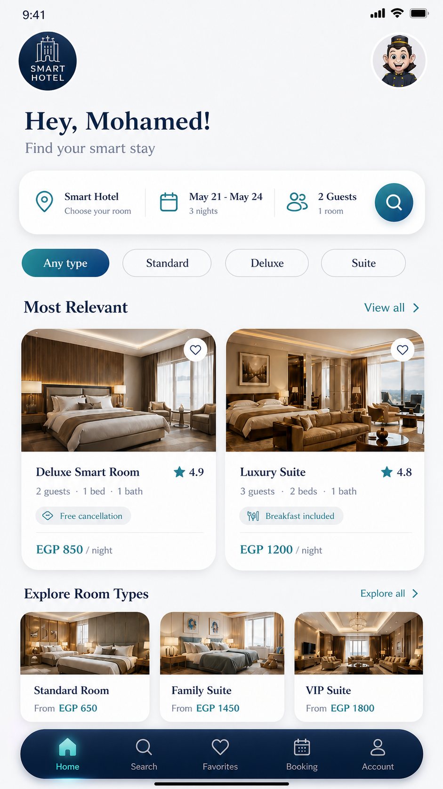
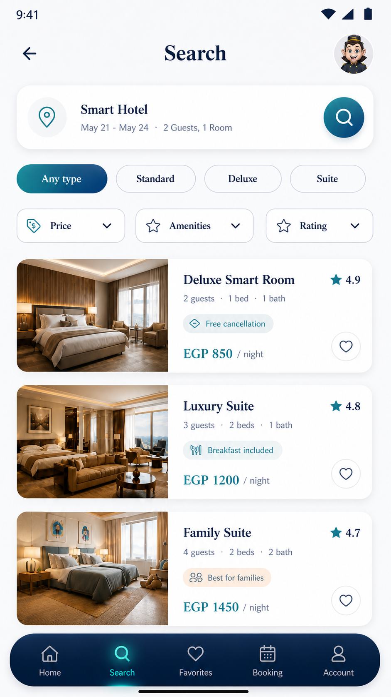
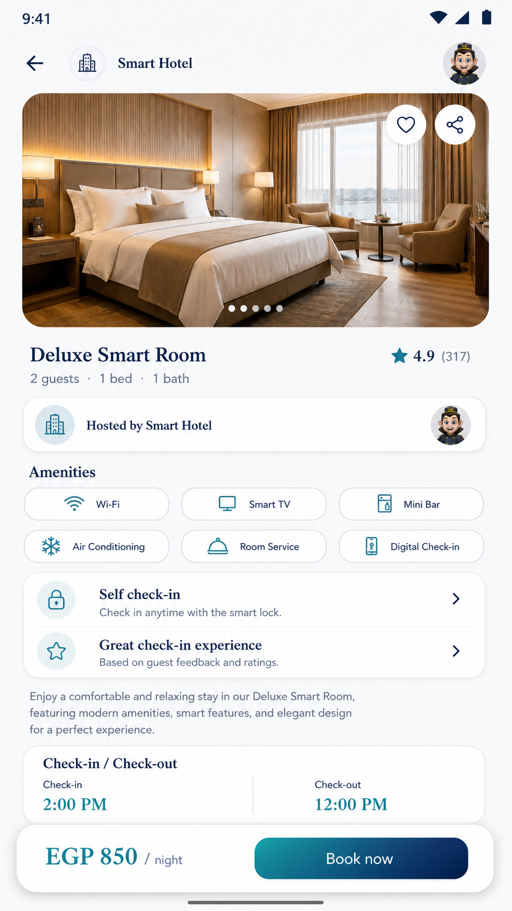
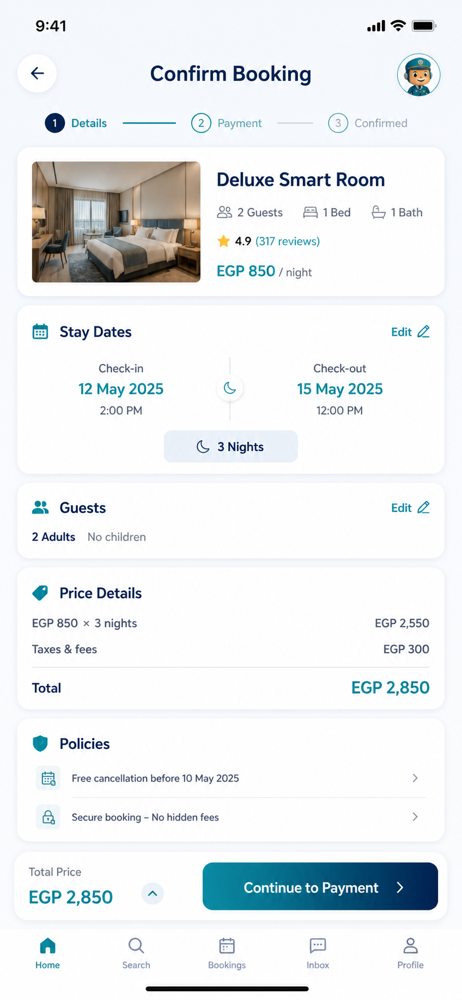
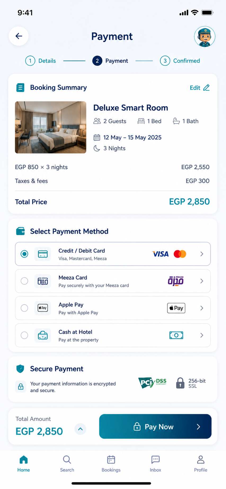
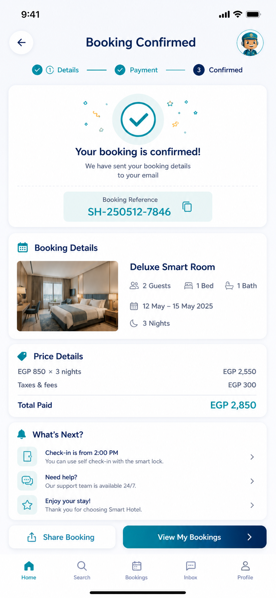
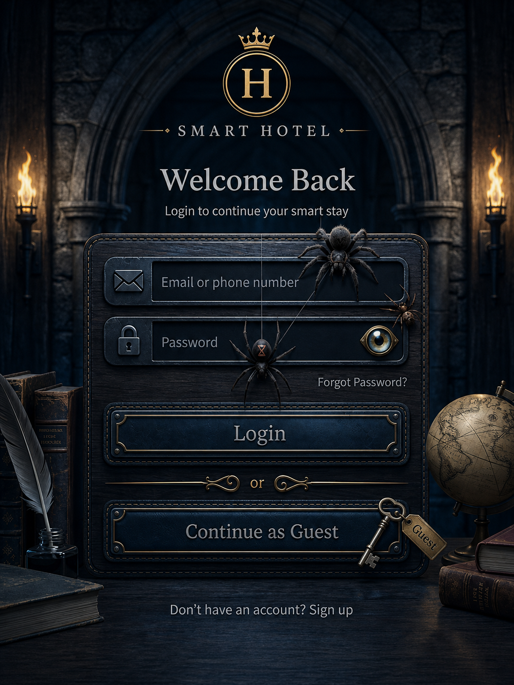
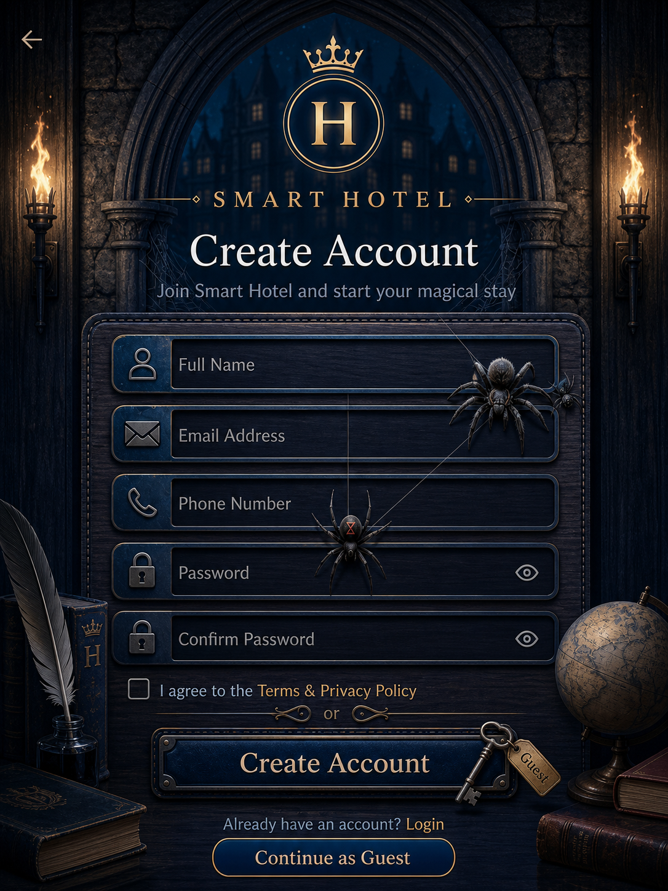

# SmartHotel 🏨

### Android Hotel Booking Application

SmartHotel is an Android hotel booking application developed with Kotlin and XML, featuring Firebase integration for application data management.

## Features

- User authentication and account creation
- Hotel room browsing and search
- Room details and amenities
- Favorites and room selection
- Booking and reservation flow
- Payment interface
- Booking confirmation and management
- User profile and account features

## Tech Stack

- Kotlin
- XML Layouts
- Android SDK
- Android Fragments
- Firebase
- Gradle

## App Screenshots

### Home & Search
 

### Room Details & Booking
 

### Payment & Confirmation
 

### My Bookings

### Authentication
 

### User Profile

## Getting Started

1. Clone this repository.
2. Open it in Android Studio.
3. Configure Firebase using your own google-services.json file if required.
4. Sync Gradle and run the application.

## Developer

**Mohamed Elshahat**

GitHub: [mohamed552m](https://github.com/mohamed552m)
